<div align="center">


# Homelab Monitor

[](https://www.youtube.com/@Chipset-BR)

**Uma dashboard só para o homelab inteiro: rede, virtualização, backups, armazenamento, mídia, casa inteligente e energia, com alertas e app Android.**


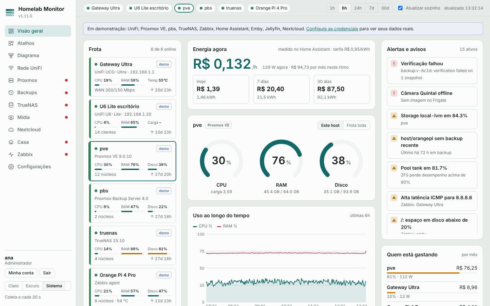

</div>

---

## Por que existe

Num homelab, cada serviço tem o seu painel: o Proxmox de um lado, o PBS de outro, a UniFi no
celular, o Zabbix, o TrueNAS, o Home Assistant… O **Homelab Monitor** junta tudo numa tela só,
lendo as APIs oficiais de cada um com tokens **somente leitura**, e acrescenta o que nenhum deles
faz sozinho: custo de energia em R$, alertas unificados (inclusive no Telegram e no celular),
diagrama da rede com status ao vivo e um assistente de IA que analisa os seus dados.

Funciona em demonstração logo na primeira execução, sem nenhuma credencial: cada serviço passa a
mostrar dados reais assim que você configura o acesso.

## Recursos

**Monitoramento**
- **Visão geral** com frota de equipamentos, medidores, gráficos, alertas e custo de energia.
- **Páginas por serviço** no estilo do ProxMenux Monitor (abas, cards, gráficos com período de 1 hora a 1 ano).
- **Histórico nativo** sempre que a fonte oferece (RRD do Proxmox e do PBS, history/trends do Zabbix); nos
  demais, histórico gravado pela própria dashboard em SQLite.
- **Alertas unificados**: serviço fora do ar, disco e pool cheios, falha de backup, SMART, temperatura,
  canal Wi-Fi congestionado, câmera offline, links públicos sem senha…

**Casa e energia**
- **Cômodos** do Home Assistant com luzes, tomadas Zigbee e consumo em R$ por aparelho.
- **Câmeras do Frigate** com imagem ou só status, sem expor o token do Home Assistant.
- **Custo de energia** medido (sensor do HA) ou estimado pela carga de cada equipamento.

**Ferramentas**
- **Diagrama da rede** interativo e editável: arrastar, zoom, ligações, status ao vivo, painel de detalhes.
- **Atalhos** no estilo Heimdall, com busca, ícones dos próprios sites e verificação de status.
- **Assistente de IA** (Claude, ChatGPT, Gemini ou Ollama local): análise de consumo, de imagens das câmeras
  e sugestões de melhoria, com controle do que é enviado.

**Segurança e acesso**
- **Login com usuários e papéis** (administrador e visualizador), **2FA** (TOTP) com códigos de recuperação.
- **Notificações no Telegram** para falhas e eventos de segurança.
- **Aparência personalizável**: nome, logo, cores e tela de login.
- **App Android** nativo com alertas em segundo plano, widget, biometria e certificados fixados.

## Capturas de tela

| | |
|---|---|
| 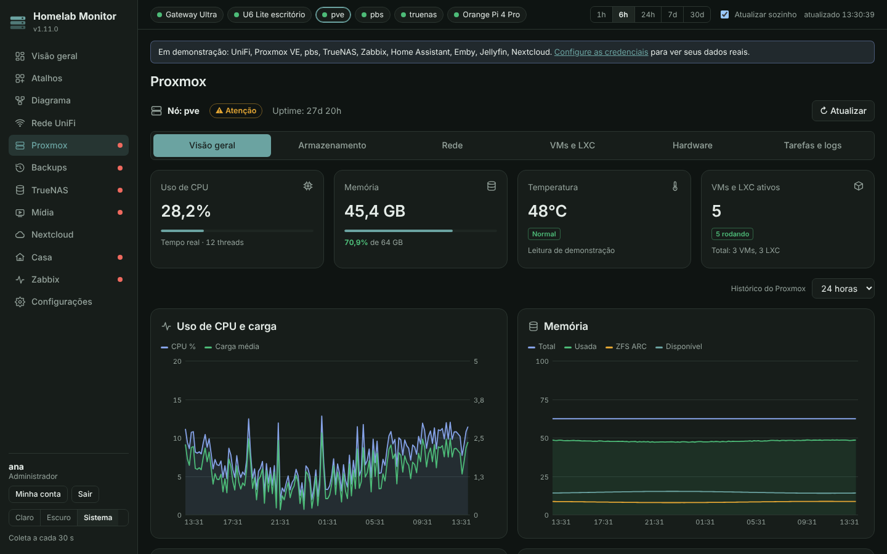 <br> **Proxmox** — nó, VMs e LXC, histórico do próprio Proxmox | 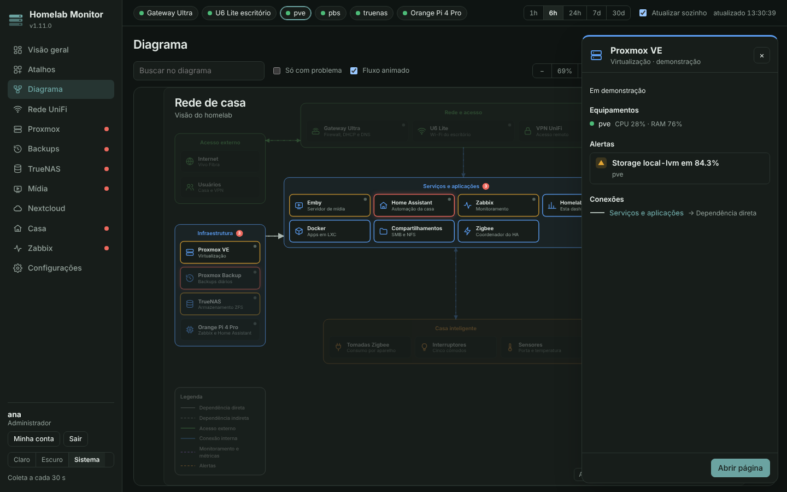 <br> **Diagrama** — interativo, com status ao vivo |
| 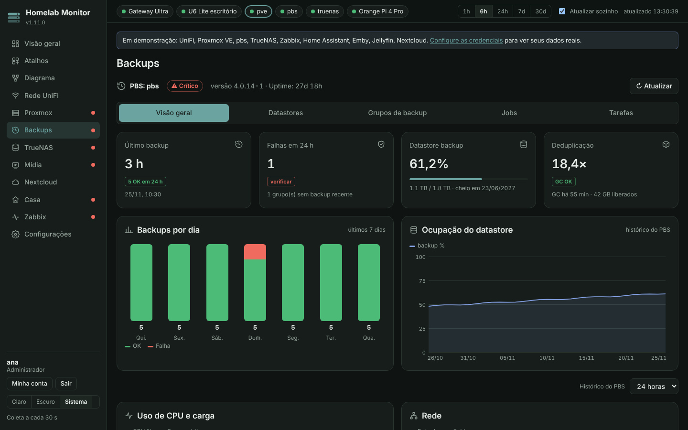 <br> **Proxmox Backup Server** — backups por dia, datastores, jobs | 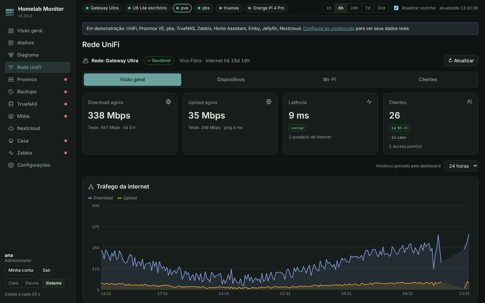 <br> **UniFi** — internet, Wi-Fi, dispositivos e clientes |
| 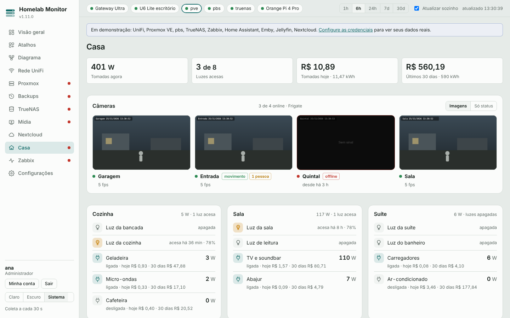 <br> **Casa** — cômodos, tomadas, luzes e câmeras | 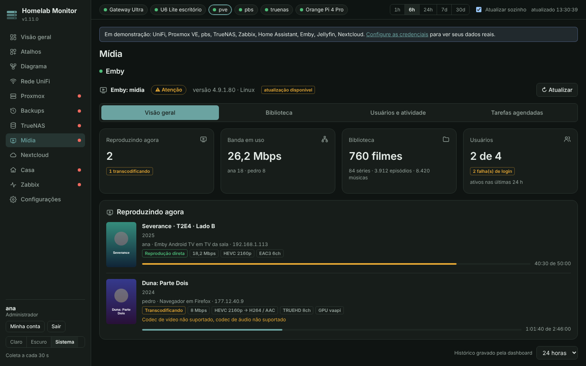 <br> **Emby e Jellyfin** — quem está assistindo e transcodificação |
| 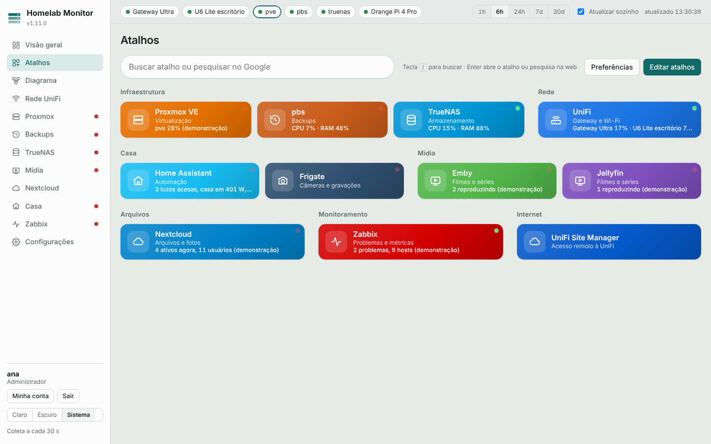 <br> **Atalhos** — acesso rápido a cada serviço | 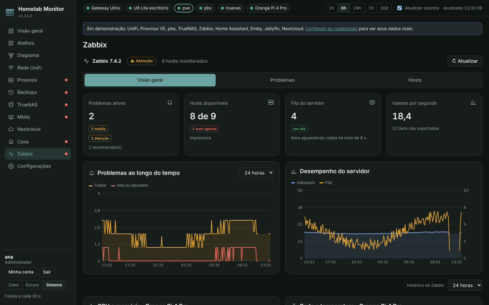 <br> **Zabbix** — problemas, hosts e histórico |

<div align="center">
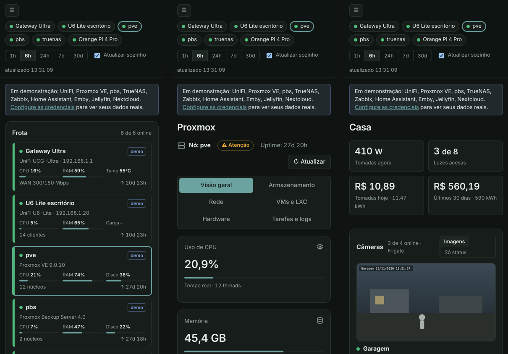<br>
<b>App Android</b> — a dashboard completa no celular, com alertas e widget
</div>

<details>
<summary><b>Mais telas</b></summary>
<br>

| | |
|---|---|
| 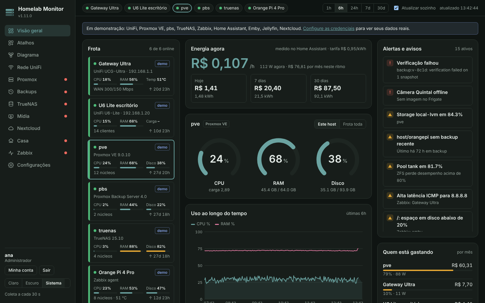 <br> **Tema escuro** | 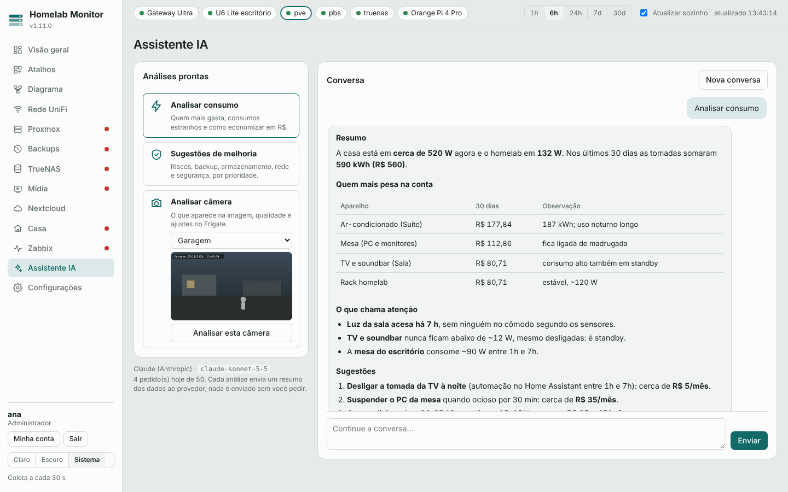 <br> **Assistente de IA** — análise de consumo |
| 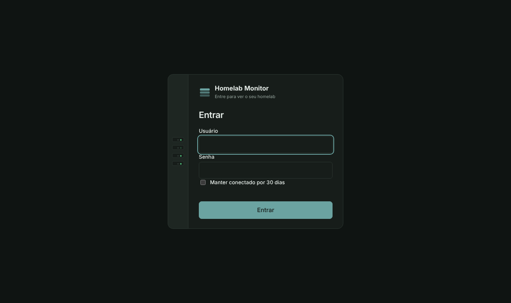 <br> **Login** — com aparência personalizável | 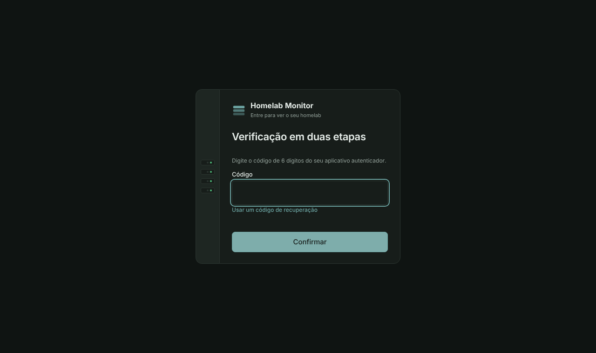 <br> **2FA** — código do aplicativo autenticador |
| 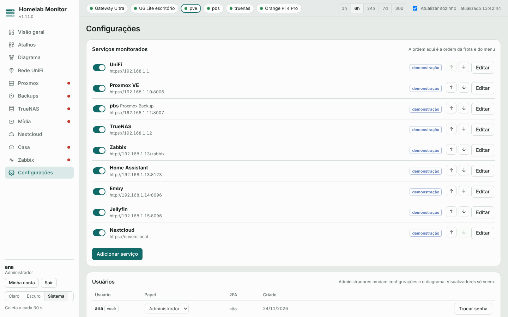 <br> **Configurações** — serviços, usuários, IA, Telegram e aparência | |

</details>

> As capturas usam o modo de demonstração (dados simulados).

## Integrações

| Serviço | O que aparece | Acesso |
|---|---|---|
| **UniFi** (Gateway, APs, switches) | Internet, latência, teste de velocidade, rádios, canais, clientes | Chave da Integration API |
| **Proxmox VE** | Nós, VMs/LXC, storages, interfaces, SMART, tarefas, log | Token `PVEAuditor` |
| **Proxmox Backup Server** | Datastores, deduplicação, grupos, jobs, GC, tarefas | Token `Audit` |
| **TrueNAS** | Pools ZFS, scrub, alertas, apps | Chave de API (WebSocket 25.04+ ou REST) |
| **Zabbix** | Problemas, hosts, fila, histórico de métricas | Token de API |
| **Home Assistant** | Cômodos, luzes, tomadas, Zigbee, câmeras do Frigate | Token de longa duração |
| **Emby / Jellyfin** | Sessões, transcodificação, bibliotecas, atividade, tarefas | Chave de API |
| **Nextcloud** | Usuários ativos, armazenamento, compartilhamentos, PHP, banco | Token do serverinfo |
| **HTTP / TCP** | Qualquer outro serviço: no ar ou não e tempo de resposta | — |

Novas integrações são uma classe Python: veja [Adicionar um tipo novo](docs/GUIA.md#adicionar-um-tipo-novo-de-integração).

## Começando

Requisitos: Docker com Compose. Funciona em x86 e ARM64 (Raspberry Pi, Orange Pi).

```bash
git clone https://github.com/SEU_USUARIO/homelab-monitor.git
cd homelab-monitor
cp .env.example .env
docker compose up -d --build
```

1. Veja o **código de configuração inicial** no log:
   ```bash
   docker compose logs homelab-monitor | grep "código de configuração"
   ```
2. Abra `http://IP-DO-SERVIDOR:8080`, crie o administrador com esse código e ative o 2FA em *Minha conta*.
3. Em **Configurações**, edite cada serviço e informe endereço e chave. Use *Testar conexão* antes de salvar.

Pronto: a dashboard sai do modo de demonstração serviço por serviço.

## Configuração

Tudo pode ser feito pela página **Configurações** ou editando `data/config.yml` (as mudanças valem
no ciclo seguinte, sem reiniciar). Segredos podem ficar no `.env` e ser referenciados como `${NOME}`.

```yaml
services:
  - id: proxmox
    type: proxmox
    name: Proxmox VE
    url: https://192.168.1.10:8006
    token_id: monitor@pve!dashboard
    token_secret: ${PVE_TOKEN_SECRET}
```

O [guia completo](docs/GUIA.md) explica como criar cada token com o mínimo de permissão, a
configuração de energia, Telegram, IA, aparência, diagrama, atalhos e a API.

## App Android

O app em [`android/`](home-lab-monitor/android/) roda a dashboard completa e acrescenta recursos de celular:

- alertas em segundo plano com canais de notificação (críticos, avisos, sessão);
- widget com estado geral, alertas e consumo em R$/h;
- bloqueio com biometria ou PIN;
- confirmação e fixação de certificados autoassinados;
- envio e download de arquivos.

Compila sem Gradle, só com pacotes do Ubuntu/Debian. Instruções em [`android/README.md`](home-lab-monitor/android/README.md).

## Arquitetura

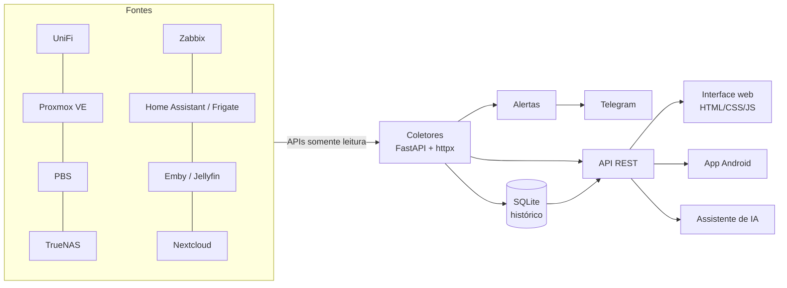

- **Backend**: Python 3.12, FastAPI, httpx, websockets; coleta assíncrona a cada 30 s.
- **Frontend**: HTML, CSS e JavaScript sem dependências nem etapa de build; gráficos em canvas.
- **Dados**: `data/config.yml`, `users.json`, histórico em SQLite, diagrama, atalhos e aparência em JSON.
- **App**: Java com APIs do próprio Android (sem bibliotecas externas), WebView com ponte nativa.

```
app/          backend: API, coletores, autenticação, IA, notificações
web/          interface
android/      app Android
docs/         guia completo e capturas de tela
```

## Segurança

- Login em todas as páginas e rotas; senhas com PBKDF2; 2FA opcional ou obrigatório.
- Limite de tentativas por conta e por IP; proteção contra CSRF; política de conteúdo restritiva.
- O primeiro administrador só pode ser criado com o código que aparece no log do servidor.
- Chaves e tokens das integrações nunca chegam ao navegador; trocar o endereço de um serviço exige digitar a chave de novo.
- Container sem privilégios, com sistema de arquivos somente leitura.

**Recomendação**: não exponha a porta na internet. Use a dashboard pela rede local, por VPN ou atrás de um
proxy reverso com HTTPS. Detalhes em [Segurança](docs/GUIA.md#segurança).

## Desenvolvimento

```bash
python3 -m venv .venv && . .venv/bin/activate
pip install -r app/requirements.txt
cd app && CONFIG_PATH=../data/config.yml DB_PATH=../data/homelab.db uvicorn main:app --reload --port 8080
```

Sem credenciais, todos os serviços rodam em modo de demonstração, o que facilita mexer na interface.
Para conferir as dependências: `pip-audit -r app/requirements.txt`.

## Licença

[MIT](LICENSE).
